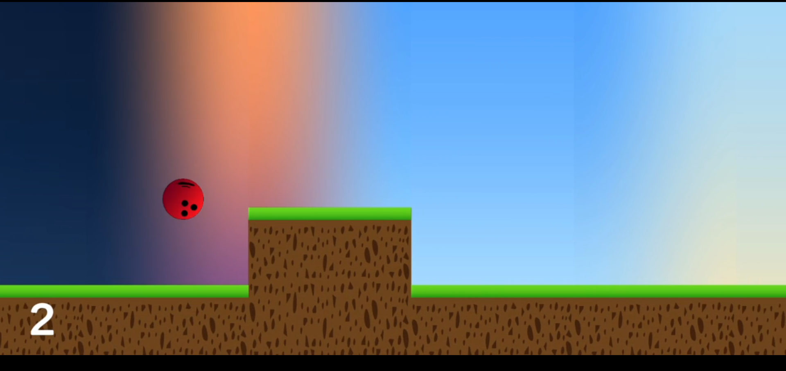
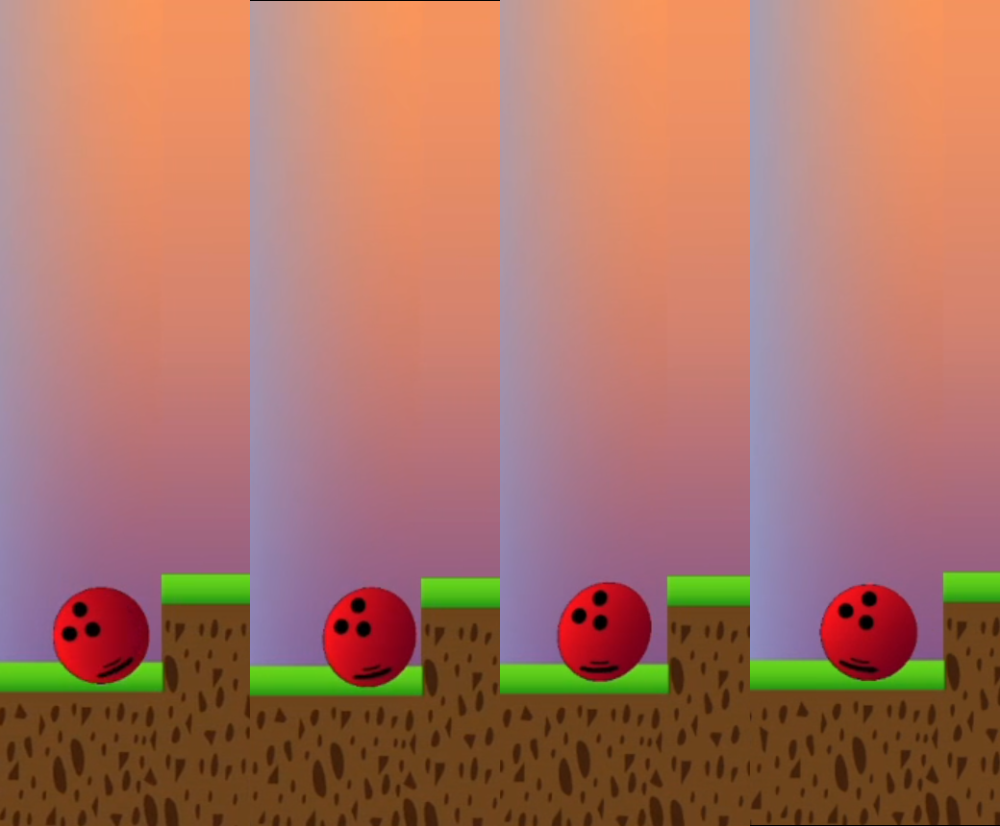
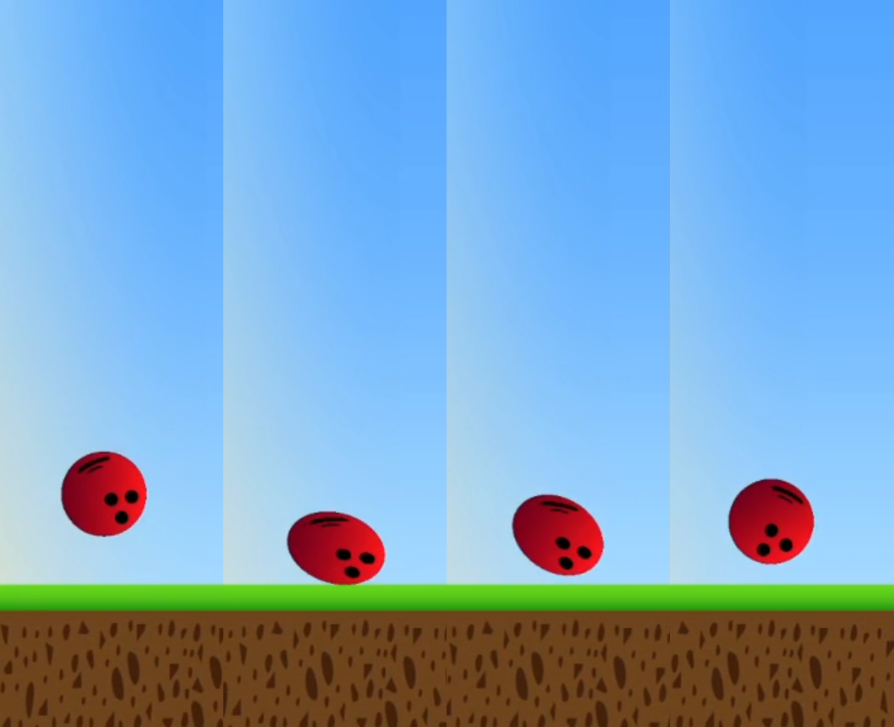
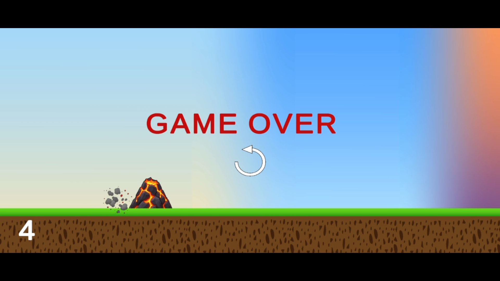

# Procedural Ball Platformer

A landscape-oriented Unity platformer featuring physics-driven ball movement, procedural terrain spawning, trajectory prediction, and impact-responsive squash-and-stretch deformation.

This project explores gameplay programming, physics interactions, procedural environment management, and mobile-oriented game development.

## Gameplay

Watch the complete gameplay demonstration:

[**Watch Gameplay on YouTube**](https://www.youtube.com/watch?v=lYtG4kdCRqs)

## Features

- **Physics-driven movement:** A controllable ball that interacts with the environment using Unity physics.
- **Procedural terrain spawning:** Terrain segments are spawned as the player progresses and removed when no longer needed.
- **Controlled terrain variation:** Ground height varies within a tested range designed around the ball's jumping capability.
- **Day-to-night visual progression:** Terrain segments follow a predefined visual sequence to transition through different times of day.
- **Trajectory prediction:** A projected path helps communicate the ball's expected jump trajectory.
- **Impact-responsive deformation:** The ball visually squashes in response to collisions, with deformation behavior demonstrated for different obstacle orientations.
- **Gameplay loop:** Obstacles, score progression, and a game-over/restart flow.

## Technical Demonstrations

### 1. Time Transition

Terrain segments follow a predefined sequence to create a visual progression from morning through evening and night, then back to morning.

[**Watch the time transition**](https://www.youtube.com/watch?v=H1KSeOUtNak)

### 2. Vertical Impact Squash

Demonstrates the ball's vertical squash response when colliding with a vertical obstacle.

[**Watch vertical impact deformation**](https://www.youtube.com/watch?v=1Xx2mnWd6sI)

### 3. Horizontal Impact Squash

Demonstrates the ball's horizontal squash response when colliding with a horizontal obstacle.

[**Watch horizontal impact deformation**](https://www.youtube.com/watch?v=dor7iCDCUKw)

### Game Over

## Technical Implementation

### Procedural Terrain Management

A terrain generator manages the creation and removal of terrain segments as the camera advances. The system keeps the active terrain count limited instead of retaining every previously visited segment.

Terrain segments use predefined dimensions and a controlled range of randomized ground heights. The visual sequence is intentionally ordered to preserve continuity in the day-to-night transition.

### Physics and Trajectory Prediction

The ball uses Unity's physics system for movement and collision handling. The trajectory predictor visualizes the expected path of a jump based on its launch conditions and gravity.

### Impact-Responsive Ball Deformation

The ball's shape changes visually in response to impacts. The demonstrations show deformation along different axes depending on the collision scenario.

This is presented as an impact-responsive visual effect, rather than a claim that the project implements a full soft-body physics solver.

### Mobile-Oriented Development

The game was developed in Unity with Android as a target platform and subsequently adapted to landscape gameplay.

## Technology

- Unity
- C#
- Unity Physics
- Touch input
- Procedural terrain spawning
- Runtime visual deformation
- Android

## Project Status

The current version includes the core gameplay loop, landscape presentation, procedural terrain management, trajectory prediction, and impact-responsive deformation.

## Author

**Mihir Pathak**

- GitHub: [MihirP-In](https://github.com/MihirP-In)
- Project: [Procedural-Ball-Platformer](https://github.com/MihirP-In/Procedural-Ball-Platformer)
